# SIPUS-Del: Sistem Informasi Perpustakaan Kampus Del

Tugas Mandiri Praktikum Minggu 05, Pemrograman & Pengujian Web (12S3101), Institut Teknologi Del.

- Nama: Kezia Vania Pasaribu
- NIM: 12S24009

Aplikasi CRUD perpustakaan kampus berbasis **Laravel 11** dengan arsitektur **MVC**, relasi Eloquent, validasi server-side, Blade Component, dan pembuktian eager loading lewat audit SQL.

## Fitur

- CRUD **Buku** dan **Kategori** (7 aksi RESTful lewat `Route::resource` + Implicit Route Model Binding)
- Relasi One-to-Many: `Kategori hasMany Buku`, `Buku belongsTo Kategori`
- Eager Loading (`Buku::with('kategori')`) di seluruh halaman index
- Validasi server-side (ISBN unik, judul minimal 5 karakter, stok minimal 0) dan proteksi CSRF di semua form
- Master layout `<x-layout>` bertema Del Purple (`#4C1D95`), pagination, flash message, dan `@forelse`
- Seeder + Factory (Faker): 5 kategori dan 20 buku
- Audit query SQL lewat `DB::listen`

## Teknologi

PHP 8.2+, Laravel 11, SQLite, Bootstrap 5 (CDN), Composer.

## Instalasi

```bash
git clone https://github.com/keziavania/ppw-2026-week5-12S24009.git
cd ppw-2026-week5-12S24009
composer install
copy .env.example .env        # Linux/macOS: cp .env.example .env
php artisan key:generate
php -r "touch('database/database.sqlite');"
php artisan migrate:fresh --seed
php artisan serve
```

Buka `http://localhost:8000`.

Catatan: pengaturan `policy.advisories.block=false` sudah ada di `composer.json` karena Laravel 11.x terkena blokir security advisory pada Composer versi terbaru. Ini hanya untuk keperluan tugas lokal.

## Struktur MVC

| Lapisan | Lokasi |
|---|---|
| Model | `app/Models/Buku.php`, `app/Models/Kategori.php` |
| View | `resources/views/buku/`, `resources/views/kategori/`, `resources/views/components/layout.blade.php` |
| Controller | `app/Http/Controllers/BukuController.php`, `KategoriController.php` |
| Routes | `routes/web.php` |
| Migrations | `database/migrations/` |
| Seeders & Factories | `database/seeders/`, `database/factories/` |

## Bukti Audit SQL (Eager Loading)

Log query ada di folder `docs/`:

- `docs/audit-sql-index-buku.txt`: halaman `/buku` hanya menjalankan 3 query (hitung total pagination, ambil 10 buku, ambil semua kategori terkait dalam satu query `WHERE id IN (...)`).
- `docs/audit-sql-lazy-vs-eager.txt`: perbandingan lazy loading (1 + N query, terjadi N+1 problem) dengan eager loading (2 query).

Query hitung total pada halaman index berasal dari `paginate()`, sehingga jumlahnya 3, bukan 2.

## Konvensi Commit

Mengikuti Conventional Commits (`feat`, `perf`, `docs`, `chore`).

---

# Pembaruan Minggu 6: Transaksi ACID, Query Builder, Session, dan Autentikasi

Branch: `week6-db-session` (melanjutkan repositori Minggu 5). Tugas Mandiri Praktikum Minggu 06, Pemrograman & Pengujian Web (12S3101).

## Akun Uji Pustakawan

| Email | Password |
|---|---|
| `pustakawan@del.ac.id` | `password123` |

Halaman login: `http://localhost:8000/login`. Seluruh rute (buku, kategori, peminjaman, pengembalian) dilindungi middleware `auth`.

## Cara Menjalankan Branch Ini

```bash
git clone https://github.com/keziavania/ppw-2026-week5-12S24009.git
cd ppw-2026-week5-12S24009
git checkout week6-db-session
composer install
copy .env.example .env        # Linux/macOS: cp .env.example .env
php artisan key:generate
php -r "touch('database/database.sqlite');"
php artisan migrate:fresh --seed
php artisan serve
```

## ERD

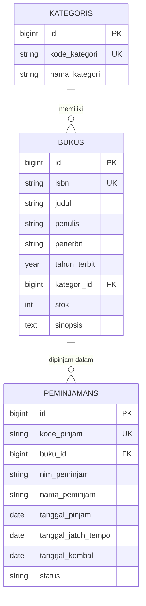

## Fitur Minggu 6

| Kriteria | Implementasi |
|---|---|
| Migrasi `peminjamans` | Foreign key `buku_id` ke `bukus` dengan `cascadeOnDelete`; relasi `Buku hasMany Peminjaman` dan `Peminjaman belongsTo Buku` |
| Transaksi ACID | Peminjaman dan pengembalian dibungkus `DB::transaction()` dengan `lockForUpdate()`; stok 0 ditolak (rollback); NIM yang sama tidak bisa meminjam buku yang sama sebelum dikembalikan; `QueryException` dicatat lewat `Log::error()` |
| Query Builder dan filter | Kartu statistik memakai `DB::table()`; katalog memakai `Buku::with('kategori')->withCount('peminjamans')`; pencarian dinamis `when()` (judul, penulis, ISBN, kategori); paginasi `withQueryString()` |
| Session, cookie, dan auth | `Auth::attempt()`, `session()->regenerate()` saat login, `invalidate()` dan `regenerateToken()` saat logout; state sesi (waktu login, pencarian terakhir, peminjam terakhir); cookie `del_last_user_email` lewat `Cookie::queue()` |
| Seeder | Akun pustakawan, 20 buku (termasuk sampel stok 0 dan stok 1), dan 3 sampel peminjaman |

## Catatan Teknis

- **Locking:** `lockForUpdate()` menghasilkan `SELECT ... FOR UPDATE` pada MySQL (penguncian per baris). SQLite tidak mendukung penguncian per baris dan mengunci seluruh database saat penulisan, sehingga hasil akhirnya tetap aman, tetapi perintah penguncian baru berefek penuh pada MySQL.
- **Zona waktu:** `APP_TIMEZONE=Asia/Jakarta`.
- **Nama cookie sesi:** `sipus_del_session` (dibentuk dari `APP_NAME`).

## Data Sampel Seeder

| Data | Nilai |
|---|---|
| Buku stok 0 | ISBN `9786020000001` ("Sampel Uji Stok Nol") |
| Buku stok 1 | ISBN `9786020000002` ("Sampel Uji Stok Satu") |
| Peminjaman sampel | `PJM-SAMPEL-001` (dikembalikan), `PJM-SAMPEL-002` (dipinjam), `PJM-SAMPEL-003` (dipinjam, lewat jatuh tempo) |

## Bukti Pengujian

### 1. Transaksi ACID: Peminjaman dan Pengembalian

**Peminjaman berhasil** (stok berkurang, riwayat berstatus Dipinjam):

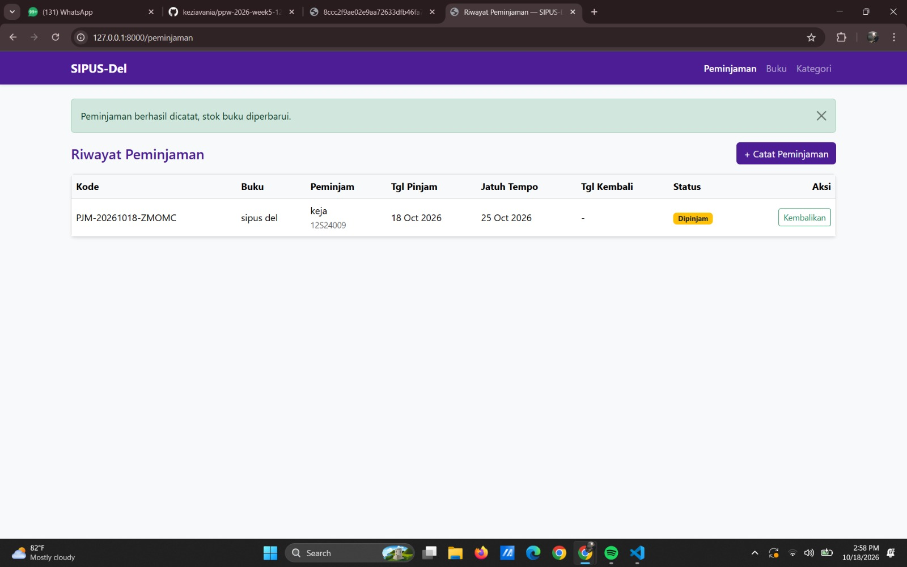

**Penolakan saat stok habis** (rollback, tidak ada riwayat baru dan stok tidak menjadi minus):

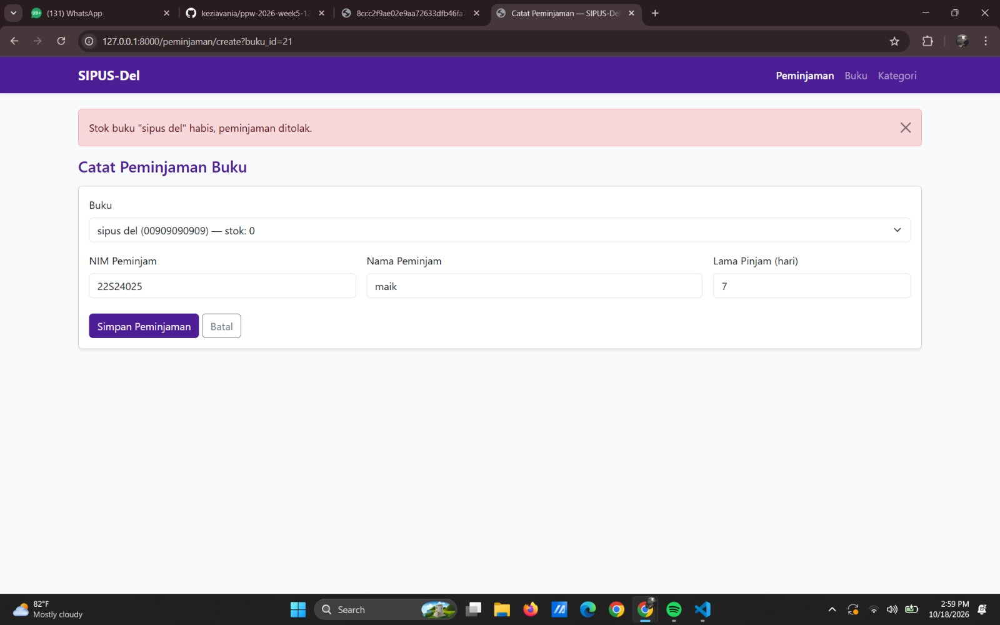

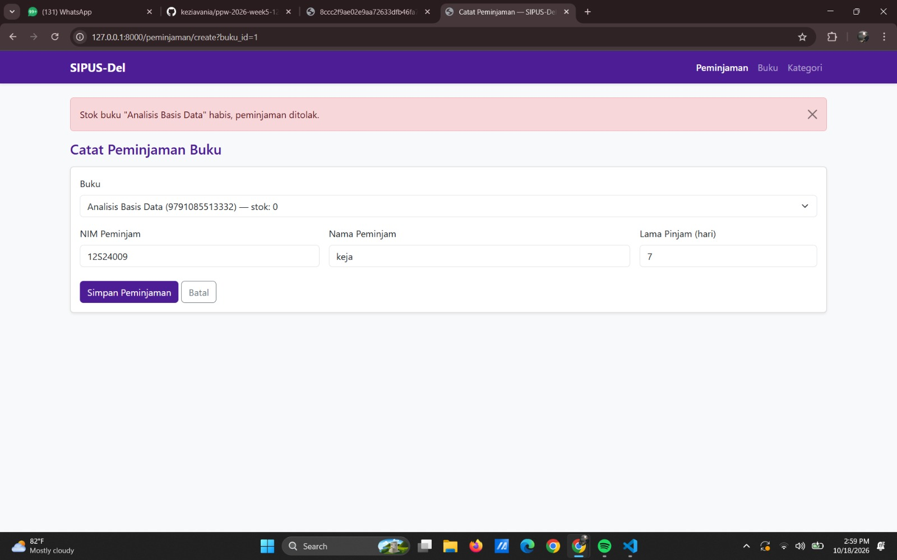

**Penolakan NIM yang sama meminjam buku yang sama** sebelum mengembalikan:

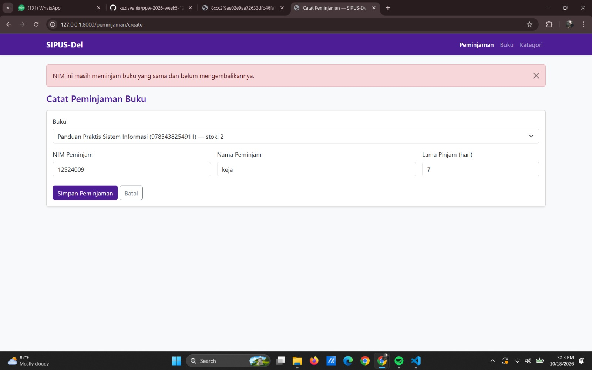

**Pengembalian berhasil** (status Dikembalikan, tanggal kembali terisi, stok bertambah):

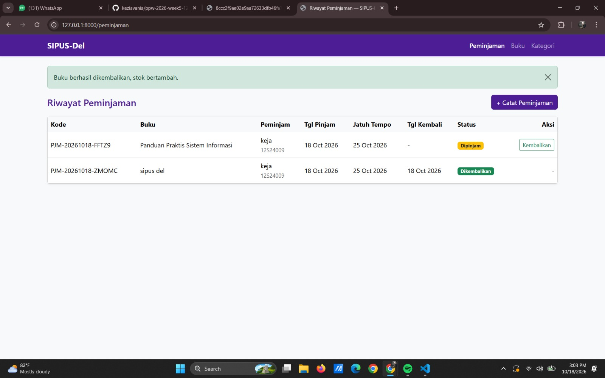

### 2. Query Builder, withCount, dan Filter Dinamis

**Kartu statistik** (`DB::table()`) dan kolom jumlah peminjaman (`withCount('peminjamans')`):

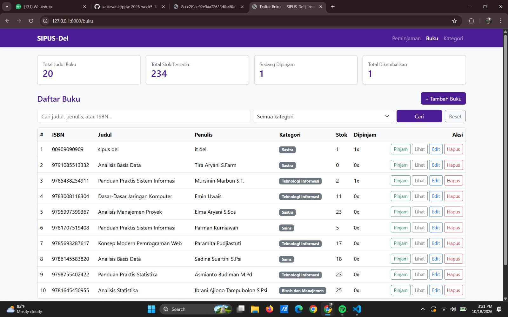

**Pencarian dinamis** (`when()`) dengan paginasi `withQueryString()`:

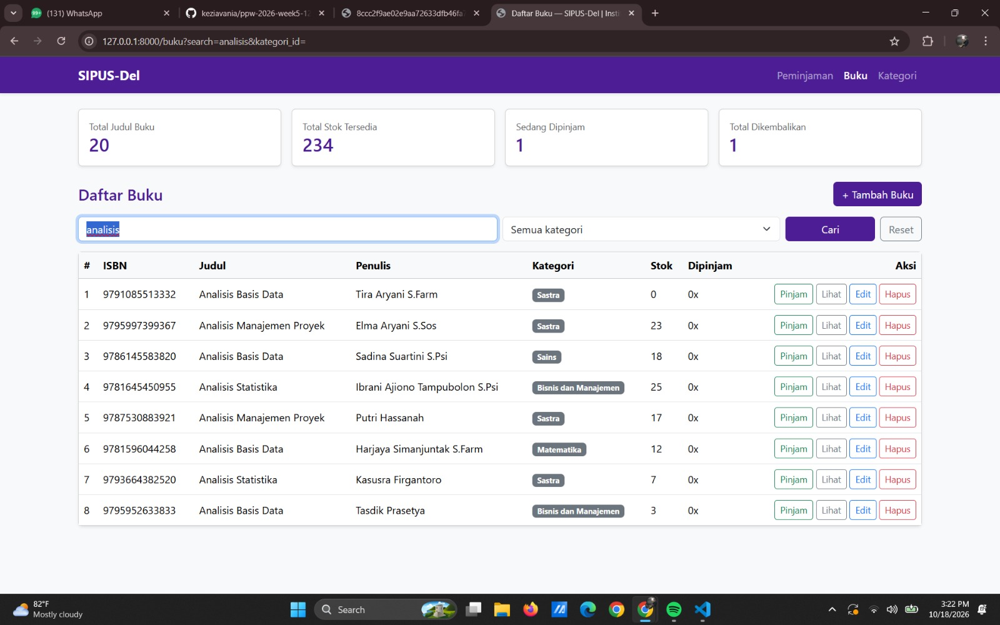

**Log query halaman katalog:** [`docs/audit-sql-katalog.txt`](docs/audit-sql-katalog.txt). Halaman katalog selalu menjalankan 8 query berapa pun jumlah bukunya (4 statistik, 1 dropdown kategori, 3 katalog), sehingga bebas N+1.

### 3. Autentikasi dan Session

**Rute dilindungi `auth`:** mengakses halaman tanpa login dialihkan ke halaman login.

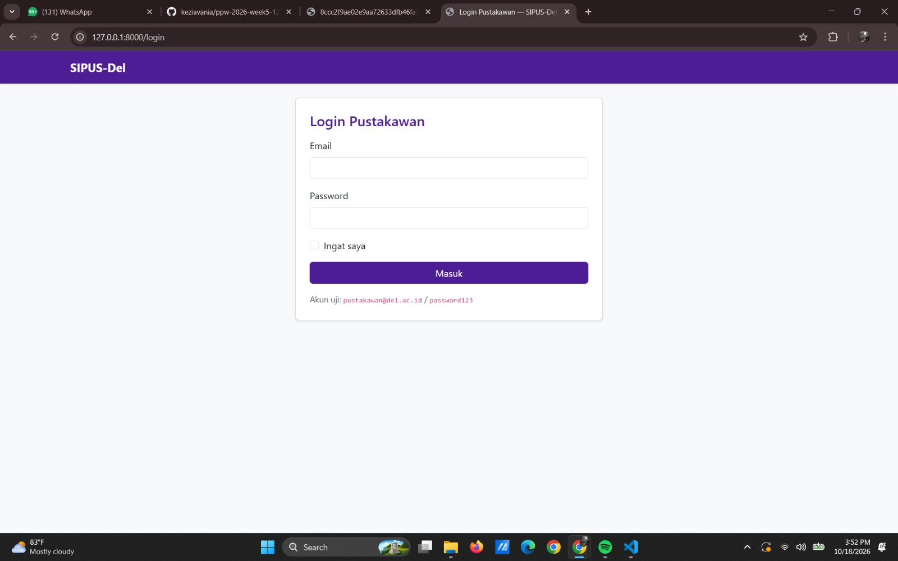

**Login gagal** (kredensial salah):

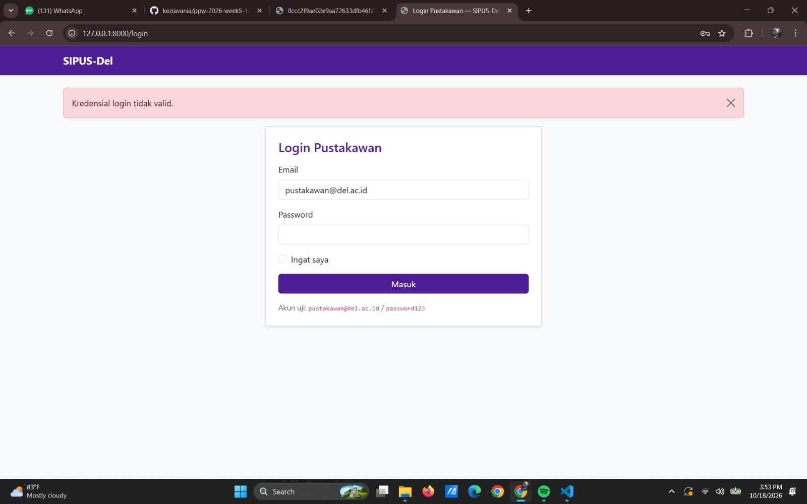

**Login berhasil** (notifikasi sesi aktif, nama pustakawan dan tombol Logout di navbar):

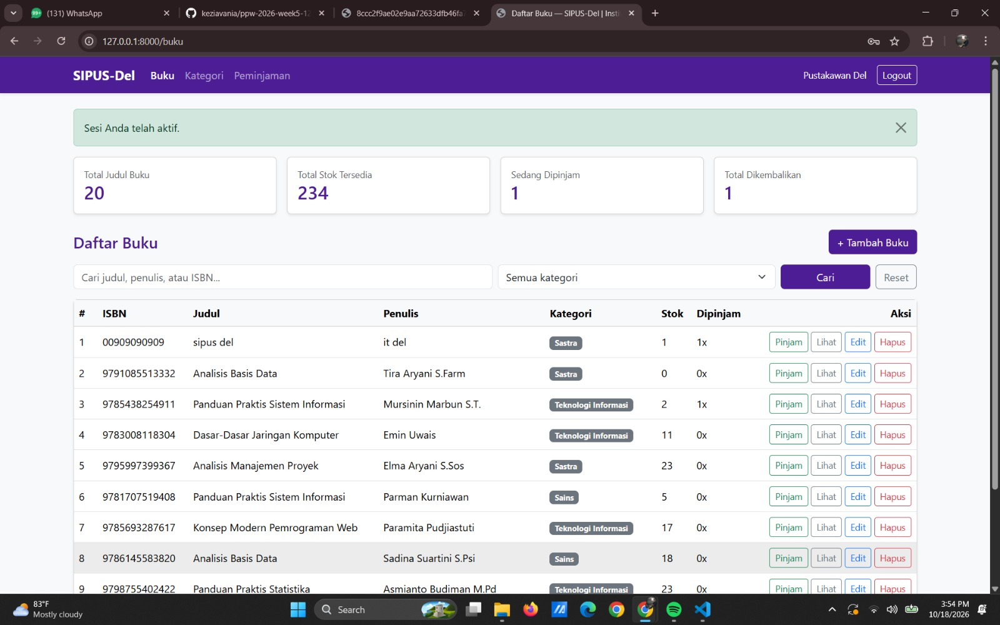

**State sesi** (waktu login, pencarian terakhir, peminjam terakhir):

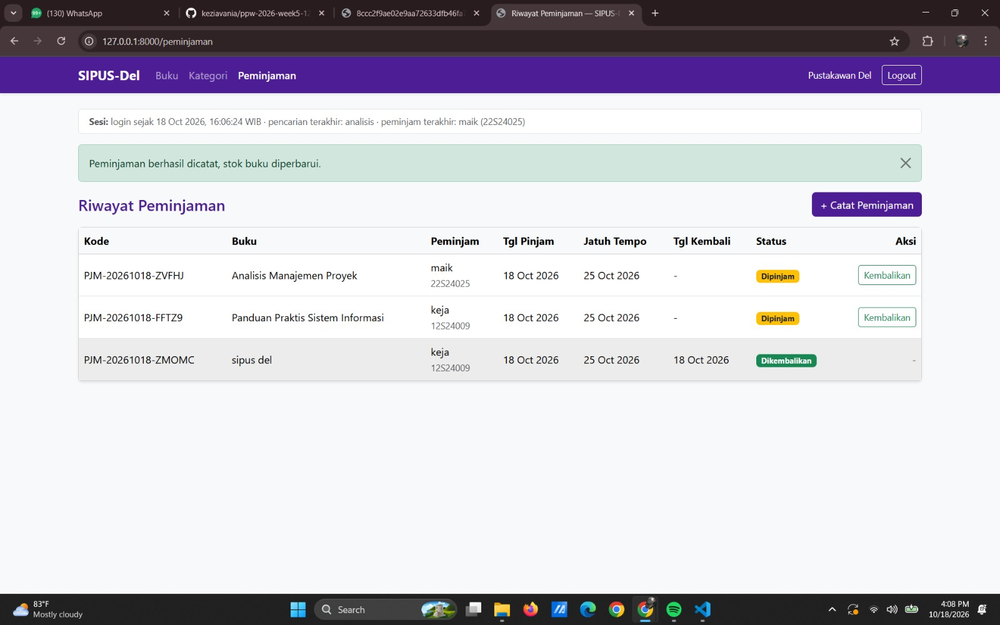

### 4. Audit Cookie di Browser DevTools

Cookie sesi `sipus_del_session` dan cookie `del_last_user_email` memiliki atribut **HttpOnly** dan **SameSite=Lax**, sehingga tidak dapat dibaca JavaScript (mitigasi pencurian cookie lewat XSS) dan tidak dikirim pada permintaan lintas situs (mitigasi CSRF). Cookie `XSRF-TOKEN` memang tidak HttpOnly karena harus dapat dibaca JavaScript.

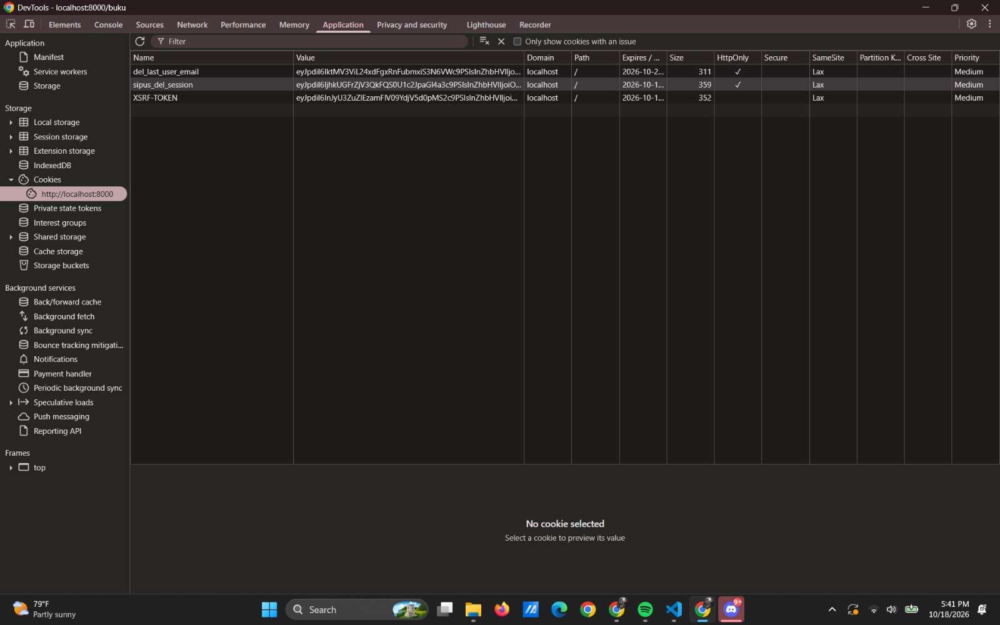

### 5. Regenerasi ID Sesi (anti-Session Fixation)

Isi tabel `sessions` diperiksa lewat `php artisan tinker` (`DB::table('sessions')->pluck('user_id', 'id')`). Sebelum login, sesi tamu memiliki ID dengan `user_id` `null`. Setelah login, `session()->regenerate()` menggantinya dengan ID baru milik pustakawan (`user_id` = 1), dan ID tamu yang lama tidak berlaku lagi.

**Sebelum login:**

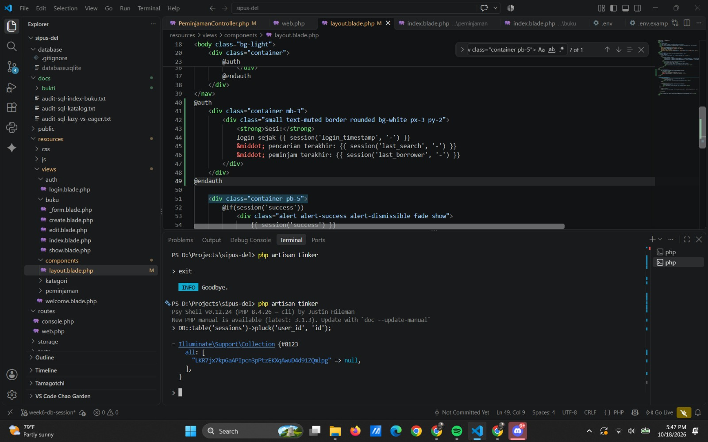

**Sesudah login:**

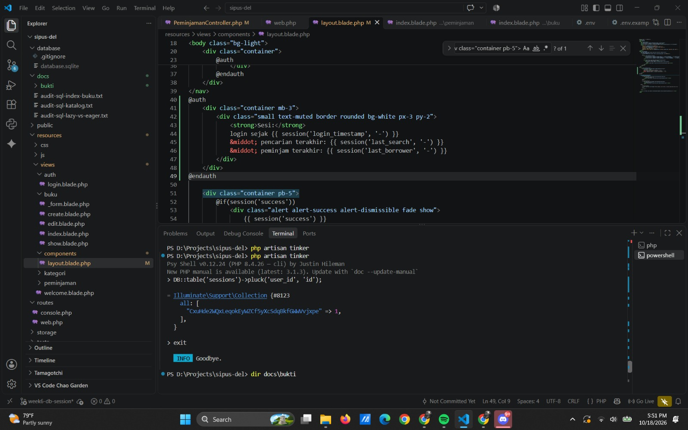

---

# Pembaruan Minggu 9 — SOAP, REST API, dan Web Services SIPUS-Del

**Praktikum:** Pemrograman dan Pengujian Aplikasi Web (PPW), Minggu 9  
**Nama:** Kezia Vania Pasaribu  
**NIM:** 12S24009  
**Branch:** `week9-rest-api`  
**Repository:** [SIPUS-Del — week9-rest-api](https://github.com/keziavania/ppw-2026-week5-12S24009/tree/week9-rest-api)

## Ringkasan

Pada Minggu 9, aplikasi SIPUS-Del dikembangkan dari aplikasi web Laravel berbasis MVC menjadi penyedia layanan **REST API** versi 1 dengan autentikasi **Laravel Sanctum Bearer Token**. Layanan mendukung katalog buku, pengelolaan data buku, peminjaman dan pengembalian buku, serta integrasi API eksternal **OpenLibrary**. Materi SOAP dipelajari melalui WSDL, pesan XML, dan SOAP Fault sebagai pembanding pendekatan REST.

## Analisis Singkat SOAP vs REST

| Aspek | SOAP | REST |
|---|---|---|
| Format pesan | XML dengan SOAP Envelope | Umumnya JSON melalui HTTP |
| Kontrak layanan | WSDL | OpenAPI |
| Penanganan kesalahan | SOAP Fault | HTTP status code dan Problem Details (RFC 7807) |
| Kelebihan | Kontrak dan standar formal; cocok bagi sistem yang mewajibkan interoperabilitas SOAP | Lebih sederhana untuk web/mobile dan mudah diuji melalui Postman |
| Penerapan pada tugas | Percobaan layanan SOAP dan analisis kelayakan | API katalog dan sirkulasi perpustakaan |

Untuk pengembangan API katalog dan transaksi berbasis web, REST dipilih karena sesuai kebutuhan klien HTTP dan penggunaan JSON. SOAP tetap relevan apabila integrasi dengan sistem lama mengharuskan WSDL dan protokol SOAP.

## Menjalankan Proyek Minggu 9

1. Clone repository dan pilih branch Minggu 9.
2. Instal dependency PHP, siapkan `.env` dari `.env.example`, dan atur database SQLite sesuai konfigurasi lokal.
3. Generate application key, jalankan migrasi dan seeder bila menggunakan database baru, kemudian jalankan server.

```bash
git clone https://github.com/keziavania/ppw-2026-week5-12S24009.git
cd ppw-2026-week5-12S24009
git checkout week9-rest-api
composer install
php artisan key:generate
php artisan migrate --seed
php artisan serve
```

> Sebelum menjalankan perintah Artisan, salin `.env.example` menjadi `.env` dan sesuaikan koneksi database. Untuk SQLite, pastikan file `database/database.sqlite` telah dibuat. Jangan jalankan `migrate:fresh --seed` pada database yang ingin dipertahankan karena menghapus tabel dan data lama.

**Base URL API:** `http://localhost:8000/api/v1`

## Daftar Endpoint REST API v1

| Method | Endpoint | Akses | Keterangan |
|---|---|---|---|
| POST | `/auth/login` | Publik | Login dan memperoleh Bearer Token |
| GET | `/auth/me` | Bearer Token | Profil pemilik token |
| POST | `/auth/logout` | Bearer Token | Mencabut token aktif |
| GET | `/bukus` | Publik | Daftar buku, pencarian, filter, sort, dan pagination |
| GET | `/bukus/{id}` | Publik | Detail buku beserta HATEOAS `_links` |
| POST | `/bukus` | Bearer Token | Menambahkan buku, berhasil `201 Created` + `Location` |
| PUT | `/bukus/{id}` | Bearer Token | Memperbarui seluruh field wajib buku |
| PATCH | `/bukus/{id}` | Bearer Token | Memperbarui sebagian field buku |
| DELETE | `/bukus/{id}` | Bearer Token | Menghapus buku tanpa pinjaman aktif; berhasil `204 No Content` |
| GET | `/bukus/{id}/referensi-eksternal` | Publik | Mengambil referensi ISBN dari OpenLibrary |
| GET | `/peminjamans` | Bearer Token | Daftar transaksi peminjaman |
| POST | `/peminjamans` | Bearer Token | Membuat transaksi peminjaman |
| PATCH | `/peminjamans/{id}/kembalikan` | Bearer Token | Mengembalikan buku dan memperbarui stok |

Parameter contoh katalog:

- Pagination: `GET /bukus?per_page=5&page=1`
- Pencarian: `GET /bukus?search=Jaringan`
- Ketersediaan: `GET /bukus?tersedia=1`

## Autentikasi dan Proteksi API

Login melalui `POST /api/v1/auth/login` mengembalikan `access_token`. Request terproteksi mengirim header:

```http
Authorization: Bearer <access_token>
Accept: application/json
```

Pengujian membuktikan `GET /auth/me` dengan token aktif mengembalikan `200`, tanpa token mengembalikan `401`, dan setelah `POST /auth/logout` token lama tidak dapat digunakan lagi (`401`). Token bersifat rahasia dan tidak boleh dimasukkan ke repository atau dokumentasi publik.

## Transaksi Peminjaman dan Pengembalian

Transaksi sirkulasi dirancang menggunakan transaksi database (`DB::transaction`) dan penguncian data (`lockForUpdate`) untuk menjaga konsistensi stok. Pengujian yang dilakukan menunjukkan:

- Peminjaman valid mencatat transaksi dan menurunkan stok buku dari **8 menjadi 7** (`201 Created`).
- Peminjaman duplikat NIM yang sama untuk buku yang masih dipinjam ditolak (`409 Conflict`).
- Buku dengan peminjaman aktif tidak dapat dihapus (`409 Conflict`).
- Pengembalian mengubah status menjadi `dikembalikan` serta memulihkan stok dari **7 menjadi 8** (`200 OK`).
- Pengembalian kedua untuk transaksi yang sama ditolak (`409 Conflict`).

Pengujian tersebut mendukung validasi konsistensi transaksi. Uji konkurensi paralel diperlukan secara terpisah bila ingin membuktikan perilaku isolasi pada banyak request serentak.

## HATEOAS, RFC 7807, dan Integrasi Eksternal

Detail buku mengembalikan objek **`_links`**, seperti `self`, `update_penuh`, `update_sebagian`, `hapus`, dan `referensi_eksternal`. Relasi `pinjam_buku` hanya ditampilkan ketika stok buku lebih dari nol.

API mengembalikan **Problem Details (RFC 7807)** pada error, menggunakan atribut `type`, `title`, `status`, `detail`, dan `instance`. Contoh hasil pengujian meliputi `401 Unauthorized`, `404 Not Found`, `409 Conflict`, dan `422 Unprocessable Content`.

Endpoint `GET /bukus/{id}/referensi-eksternal` bertindak sebagai **API consumer** terhadap OpenLibrary berdasarkan ISBN. Data OpenLibrary merupakan metadata rujukan eksternal, bukan perubahan otomatis pada data lokal. Kecocokan judul dengan koleksi lokal bergantung pada akurasi ISBN yang tersimpan.

## Ringkasan Hasil Pengujian Postman

| Skenario | Status teramati | Hasil |
|---|---|---|
| Login dengan kredensial uji | 200 | Berhasil |
| Profil dengan token aktif | 200 | Berhasil |
| Profil tanpa token / token setelah logout | 401 | Akses ditolak |
| Logout | 200 | Berhasil |
| Daftar, pencarian, filter, detail, pagination katalog | 200 | Berhasil |
| Detail buku tidak ditemukan | 404 | Error terstruktur |
| Menambah buku tanpa token | 401 | Akses ditolak |
| Menambah buku dengan data kosong | 422 | Validasi berjalan |
| Menambah buku valid | 201 | Buku dibuat, header `Location` tersedia |
| PATCH perubahan stok | 200 | Perubahan parsial berjalan |
| PUT pembaruan data buku | 200 | Pembaruan penuh berjalan |
| Peminjaman valid | 201 | Stok berkurang |
| Peminjaman duplikat | 409 | Ditolak |
| Hapus buku dengan peminjaman aktif | 409 | Ditolak |
| Pengembalian valid | 200 | Stok kembali |
| Pengembalian kedua | 409 | Ditolak |
| Hapus buku uji tanpa peminjaman | 204 | Berhasil; body kosong |
| Pengambilan metadata OpenLibrary | 200 | Berhasil |

Bukti bergambar tiap skenario tercatat pada [indeks 25 screenshot pengujian API](docs/bukti/week9-rest-api/README.md). Bukti tambahan SOAP/WSDL dan stok habis dari praktikum sebelumnya tersimpan dalam [folder bukti](docs/bukti/); periksa nama filenya saat menautkan ke laporan.

## Dokumentasi Pendukung

- [Kontrak OpenAPI v1](docs/openapi-sipus-v1.yaml)
- [Postman Collection API v1](docs/SIPUS-Del-API-v1.postman_collection.json)
- [Indeks screenshot pengujian Minggu 9](docs/bukti/week9-rest-api/README.md)
- [Folder bukti keseluruhan](docs/bukti/)

Untuk menguji API di Postman, impor file Collection, sesuaikan `base_url`, lakukan login, dan isi variabel Bearer Token **secara lokal**. Jangan commit kredensial atau token asli.

## Catatan Perbaikan

Saat pengujian awal, nama kategori tampil `null` karena `BukuResource.php` membaca `$this->kategori->nama`, sedangkan nama atribut pada model adalah `nama_kategori`. Resource diperbaiki agar membaca `$this->kategori->nama_kategori` dan kemudian menampilkan kategori buku dengan benar pada respons detail. Pengujian `POST /bukus` juga menemukan field `penerbit` dan `tahun_terbit` belum divalidasi di controller; aturan validasi telah disesuaikan dan permintaan berhasil mengembalikan `201 Created`.

> Catatan keamanan: README publik sebaiknya tidak memuat sandi akun aktif. Jika akun `pustakawan@del.ac.id` tetap dicantumkan sebagai contoh, pastikan sandinya khusus lingkungan lokal/seed data, bukan kata sandi layanan yang digunakan di luar praktikum.
